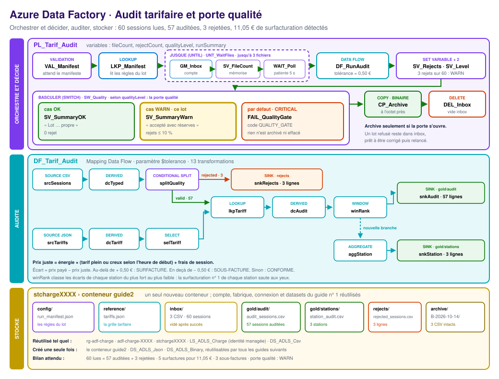
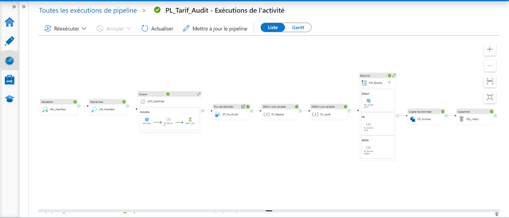
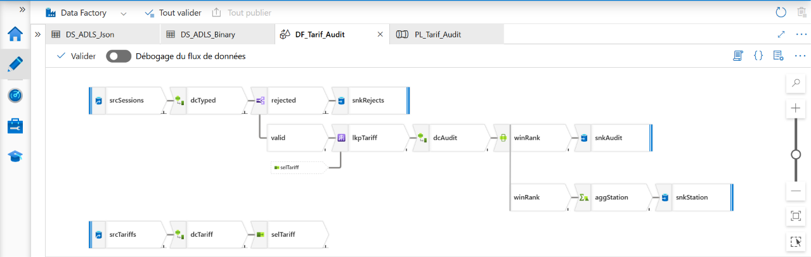
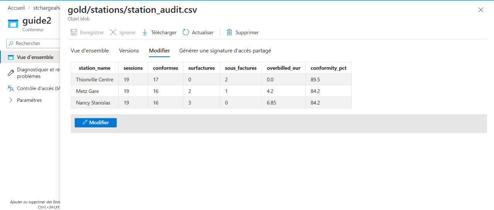
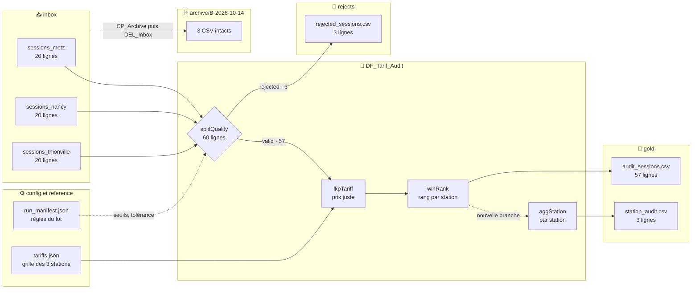

<a id="top"></a>

<div align="center">

# ⚡ Azure Data Factory · Guide n° 2 · Audit tarifaire et porte qualité

**Un pipeline qui audite chaque facture et décide seul de la qualité de son lot : piloté par un manifeste JSON, il attend que tous les fichiers soient arrivés, recalcule le prix juste de chaque session avec la grille tarifaire, classe les écarts, ouvre ou ferme une porte qualité, puis archive le lot à l'octet près avant de vider la boîte de réception.**


**[📘 Guide n° 2 pas à pas (PDF, 7 pages)](docs/Guide_ADF_Tarif_Audit_Public_2.pdf)** · **[📂 Données source](data/)** · **[🏗️ Architecture](#architecture)** · **[🚀 Reproduire](#reproduire)**

<br/>



<sub>Trois couches, de haut en bas : ce qui orchestre et décide, ce qui audite, où vivent les données. Les nombres sur les flèches sont les volumes réellement observés à l'exécution.</sub>

</div>

---

## ⚡ En bref

| 📥 Entrée | ⚙️ Traitement | 📤 Sortie |
|:---:|:---:|:---:|
| **1 manifeste** JSON qui fixe les règles du lot, **1 grille tarifaire** JSON et **3 fichiers CSV** de sessions | **1 pipeline** de 9 étapes qui attend, vérifie, audite et décide, **1 data flow Spark** de 13 transformations | **57 sessions auditées** et classées, **1 rapport par station**, **3 rejets** isolés, **1 archive** fidèle, **0 ligne perdue** |

> **Série Azure Data Factory, guide n° 2.** Chaque guide de la série construit un pipeline complet, reproductible de bout en bout, avec ses données, son diagramme et son guide PDF. Ce guide prolonge le **[guide n° 1](https://github.com/abdoulhamiddiallo/adf-pipeline-express-1)** et réutilise **exactement les mêmes ressources Azure** : même groupe de ressources, même fabrique, même compte de stockage, même connexion. Il n'ajoute qu'un conteneur et deux datasets.

---

## 🖼️ Aperçu

### Le pipeline `PL_Tarif_Audit`, exécuté avec succès

Chaque activité est au vert : le manifeste est validé puis lu, la boucle *Jusque* compte les fichiers jusqu'à ce que le lot soit complet, le data flow audite, la porte qualité *Basculer* choisit le cas `WARN`, l'archive est copiée puis la boîte de réception est vidée.



### Le data flow `DF_Tarif_Audit`

Deux sources, les sessions en CSV et la grille en JSON, se rejoignent par station. Chaque session reçoit son prix juste, son écart et un verdict, puis un rang dans sa station. Une nouvelle branche agrège le rapport par station, et les lignes inexploitables partent dans leur propre récepteur.



### Le rapport publié `station_audit.csv`



---

<a id="resultats-cles"></a>

## 📊 Résultats clés

| Indicateur | Résultat |
|---|---|
| Fichiers attendus par le manifeste | **3**, comptés par la boucle *Jusque* avant tout traitement |
| Sessions lues | **60** (20 par station) |
| Sessions auditées | **57**, chacune avec son prix juste, son écart, son verdict et son rang |
| Sessions rejetées | **3** : `MET-2900` (énergie négative), `NAN-2900` (prix vide), `THI-2900` (énergie vide) |
| Lignes perdues | **0** : 60 = 57 + 3 |
| Surfactures détectées | **5** sessions, pour **11,05 €** payés en trop |
| Sous-factures détectées | **3** sessions, pour **3,25 €** non perçus |
| Niveau de la porte qualité | **WARN** : 3 rejets sur 60, soit 5 %, sous le seuil de 10 % du manifeste |
| Archive | **3 CSV** copiés intacts dans `archive/B-2026-10-14/`, puis `inbox` vidé |
| Nouvelles ressources Azure | **0** : tout est réutilisé depuis le guide n° 1 |

**Le rapport publié dans `gold/stations/station_audit.csv` :**

| Station | Sessions | Conformes | Surfactures | Sous-factures | Surfacturation (€) | Conformité (%) |
|---|---:|---:|---:|---:|---:|---:|
| Metz Gare | 19 | 16 | 2 | 1 | 4,20 | 84,2 |
| Nancy Stanislas | 19 | 16 | 3 | 0 | 6,85 | 84,2 |
| Thionville Centre | 19 | 17 | 0 | 2 | 0,00 | 89,5 |
| **Total** | **57** | **49** | **5** | **3** | **11,05** | **86,0** |

**Les surfactures classées n° 1 de leur station par la fenêtre `winRank`, dans `gold/audit/audit_sessions.csv` :**

| Station | Session | Payé (€) | Prix juste (€) | Écart (€) | Verdict |
|---|---|---:|---:|---:|---|
| Nancy Stanislas | `NAN-2011` | 25,01 | 21,91 | +3,10 | SURFACTURE |
| Metz Gare | `MET-2004` | 19,99 | 17,59 | +2,40 | SURFACTURE |

**Le bilan écrit par le pipeline lui-même, dans la variable `runSummary` :**

```text
Lot B-2026-10-14 accepté avec réserves : 57 sessions auditées, 3 rejetées, 3 stations au rapport
```

**La preuve que la porte qualité protège le lot.** En abaissant le seuil du manifeste à `"max_reject_pct": 2`, sans toucher au pipeline, le même lot est refusé : l'activité `FAIL_QualityGate` s'arrête avec le code `QUALITY_GATE`, rien n'est archivé et rien n'est effacé.

```text
Porte qualité fermée pour le lot B-2026-10-14 : 3 lignes rejetées, au-delà du seuil de 2 %
```

---

## 💼 Impact métier

Un opérateur de bornes de recharge exploite trois stations en Lorraine : **Metz Gare**, **Nancy Stanislas** et **Thionville Centre**. Le service financier soupçonne des erreurs de facturation. La grille tarifaire paraît simple mais elle est piégeuse : un prix au kWh en heures pleines, un autre en heures creuses, des plages horaires propres à chaque station et des frais fixes par session. Ce pipeline recalcule chaque facture et livre la réponse chaque jour, sans intervention humaine.

- **Des clients protégés.** Cinq sessions ont été payées trop cher, pour 11,05 € au total. Elles sont nommées, chiffrées et classées : le service client sait exactement qui rembourser, en commençant par le plus gros écart.
- **Un manque à gagner visible.** Trois sessions ont été sous-facturées. L'erreur coûte aussi à l'opérateur, et elle est désormais mesurée.
- **Une station à surveiller.** Nancy Stanislas concentre 6,85 € de surfacturation sur trois sessions : le signal pointe vers un paramétrage de borne à vérifier, pas vers un hasard.
- **Des règles pilotées par le métier.** Le seuil de rejet et la tolérance d'audit vivent dans un fichier JSON. La finance resserre ou relâche une règle sans demander de republication du pipeline.
- **Aucun lot douteux ne passe.** Un lot trop abîmé est refusé avec un message clair, et ses fichiers restent en place pour être corrigés puis relancés.
- **Aucune donnée détruite par erreur.** La boîte de réception n'est vidée qu'après une archive réussie, et seulement si la porte s'est ouverte.

---

## 🧭 Synthèse

Le guide n° 1 transformait des données. Ce guide n° 2 leur apprend à **juger et à décider** :

1. **Il attend son contrat.** Une activité *Validation* bloque tout tant que le manifeste `run_manifest.json` n'existe pas, puis une *Recherche* (*Lookup*) en lit les règles.
2. **Il attend que le lot soit complet.** Une boucle *Jusque* (*Until*) compte les fichiers avec *Get Metadata*, patiente cinq secondes avec *Attendre* (*Wait*), recompte, et n'avance qu'une fois le nombre attendu atteint.
3. **Il confronte chaque ligne à une référence.** Le data flow joint les sessions à la grille tarifaire JSON avec une *Recherche de data flow*, recalcule le prix juste selon l'heure de début et rend un verdict avec une tolérance transmise en paramètre.
4. **Il classe au lieu de résumer.** Une *Fenêtre* (*Window*) donne à chaque session son rang dans sa station, sans perdre une seule ligne, pendant qu'une nouvelle branche agrège le rapport par station.
5. **Il décide lui-même de la qualité.** Un *Basculer* (*Switch*) choisit entre trois niveaux, `OK`, `WARN` et `CRITICAL`, calculés en entiers à partir du seuil du manifeste. Le cas par défaut arrête tout avec une activité *Échec* (*Fail*).
6. **Il range avant d'effacer.** Une *Copie binaire* archive le lot octet pour octet, puis une activité *Supprimer* (*Delete*) vide la boîte de réception.

---

## ⚙️ Le pipeline

### Pipeline `PL_Tarif_Audit`

Quatre variables de type String : `fileCount` (valeur par défaut `0`), `rejectCount`, `qualityLevel` et `runSummary`.

| # | Activité | Type (nom dans l'interface en français) | Rôle |
|:-:|---|---|---|
| 1 | `VAL_Manifest` | Validation | Attend `config/run_manifest.json`, deux minutes au plus, au lieu des 12 heures par défaut |
| 2 | `LKP_Manifest` | Lookup (Recherche) | Lit les règles du lot, *Première ligne uniquement*, relues ensuite avec `output.firstRow` |
| 3 | `UNT_WaitFiles` | Until (Jusque) | Boucle jusqu'à ce que `fileCount` atteigne `expected_files`, cinq minutes au plus |
| 3a | `GM_Inbox` | Get Metadata (Obtenir des métadonnées) | Liste `inbox` (*Éléments enfants*) |
| 3b | `SV_FileCount` | Set variable (Définir une variable) | Mémorise le nombre de fichiers trouvés |
| 3c | `WAIT_Poll` | Wait (Attendre) | Patiente cinq secondes avant de recompter |
| 4 | `DF_RunAudit` | Data flow (Flux de données) | Exécute `DF_Tarif_Audit` avec la tolérance du manifeste |
| 5 | `SV_Rejects` | Set variable | Compte les rejets, même quand le récepteur est absent des métriques |
| 6 | `SV_Level` | Set variable | Calcule `OK`, `WARN` ou `CRITICAL` |
| 7 | `SW_Quality` | Switch (Basculer) | La porte qualité, trois comportements selon `qualityLevel` |
| 7a | `SV_SummaryOK` | Set variable | Cas `OK` : bilan d'un lot propre |
| 7b | `SV_SummaryWarn` | Set variable | Cas `WARN` : bilan d'un lot accepté avec réserves |
| 7c | `FAIL_QualityGate` | Fail (Échec) | Cas par défaut : arrêt avec le code `QUALITY_GATE` |
| 8 | `CP_Archive` | Copy data, binaire | Copie `inbox` vers `archive/B-2026-10-14/`, hiérarchie conservée |
| 9 | `DEL_Inbox` | Delete (Supprimer) | Vide `inbox`, seulement après l'archive |

### Data flow `DF_Tarif_Audit`

Un paramètre de data flow, `tolerance` (double, `0.5` par défaut), reçoit sa valeur du manifeste.

| Étape | Transformation | Ce qu'elle fait |
|---|---|---|
| `srcSessions` | Source CSV | Lit les trois fichiers de `inbox`, schéma découvert à l'exécution (*schema drift*) |
| `dcTyped` | Derived column | Type la station, l'heure de début, l'énergie et le prix avec `byName()` |
| `splitQuality` | Conditional split | Écarte les sessions à l'énergie vide ou négative, au prix vide ou à l'heure illisible |
| `srcTariffs` | Source JSON | Lit la grille, forme du document *Tableau de documents* |
| `dcTariff` | Derived column | Type les six colonnes de la grille |
| `selTariff` | Select | Ne garde que les colonnes typées, pour éviter deux colonnes `station` après la jointure |
| `lkpTariff` | Lookup | Ajoute à chaque session la ligne de grille de sa station, sans jamais dupliquer de session |
| `dcAudit` | Derived column | Calcule la période tarifaire, le prix juste, l'écart et le verdict |
| `winRank` | Window | Classe les écarts de chaque station du plus fort au plus faible avec `rank()` |
| `aggStation` | Aggregate, nouvelle branche | Sessions, conformes, surfactures, sous-factures, montant surfacturé et taux de conformité |
| `snkAudit` | Sink | Écrit `gold/audit/audit_sessions.csv` |
| `snkStation` | Sink | Écrit `gold/stations/station_audit.csv` |
| `snkRejects` | Sink | Écrit `rejects/rejected_sessions.csv` |

### Les expressions qui font le travail

**Le prix juste et l'écart**, dans `dcAudit` : l'heure de début choisit le tarif plein ou creux, puis on ajoute les frais de session.

```text
expected_eur = round(energy * iif(start_hour >= peak_start && start_hour < peak_end, peak_eur, offpeak_eur) + session_fee, 2)
gap_eur      = round(price - energy * iif(start_hour >= peak_start && start_hour < peak_end, peak_eur, offpeak_eur) - session_fee, 2)
```

**Le verdict**, avec la tolérance reçue du pipeline. L'écart y est recalculé en entier, pour que l'expression ne dépende d'aucune autre colonne de la même transformation :

```text
verdict = iif(round(price - energy * iif(start_hour >= peak_start && start_hour < peak_end, peak_eur, offpeak_eur) - session_fee, 2) > $tolerance, 'SURFACTURE',
          iif(round(price - energy * iif(start_hour >= peak_start && start_hour < peak_end, peak_eur, offpeak_eur) - session_fee, 2) + $tolerance < 0, 'SOUS-FACTURE', 'CONFORME'))
```

**La condition de sortie de la boucle** `UNT_WaitFiles` :

```text
@greaterOrEquals(int(variables('fileCount')), activity('LKP_Manifest').output.firstRow.expected_files)
```

**Le niveau de qualité**, calculé en entiers, sans division, donc sans arrondi trompeur :

```text
@if(greater(mul(int(variables('rejectCount')), 100), mul(add(activity('DF_RunAudit').output.runStatus.metrics.snkAudit.rowsWritten, int(variables('rejectCount'))), activity('LKP_Manifest').output.firstRow.max_reject_pct)), 'CRITICAL', if(greater(int(variables('rejectCount')), 0), 'WARN', 'OK'))
```

### Les choix qui font la différence

- **Un manifeste plutôt que des valeurs en dur.** Le nom du lot, le nombre de fichiers attendus, le seuil de rejet et la tolérance d'audit se changent dans un fichier, sans republier le pipeline.
- **Une attente active plutôt qu'un pari.** Les fichiers arrivent rarement tous ensemble. La boucle *Jusque* refuse de traiter un lot incomplet et s'arrête proprement au bout de cinq minutes si un fichier manque.
- **Une Recherche plutôt qu'une Jointure.** La *Recherche de data flow* garde toutes les sessions et n'ajoute qu'une ligne de grille à chacune : aucune session ne peut être dupliquée par erreur.
- **Une Fenêtre plutôt qu'un simple tri.** `rank()` compare sans regrouper : chaque session garde sa ligne et reçoit son rang dans sa station.
- **Un Switch plutôt qu'un If.** La qualité n'est pas binaire. Trois niveaux donnent trois comportements, et le cas par défaut attrape tout ce qui n'est pas explicitement accepté : c'est la définition d'une porte sûre.
- **Un ordre qui fait la sécurité.** *Supprimer* est définitif. On ne supprime donc qu'après une archive réussie, et seulement si la porte s'est ouverte.
- **Des types alignés.** Dans `aggStation`, les deux branches du `iif` passent par `toString()` puis le tout par `toDouble()` : un `iif` exige des branches de même type.

---

## 🔗 Lignage des données



| Dossier de `guide2` | Contenu | Format | Volume |
|---|---|---|---|
| `config` | Le manifeste : règles du lot | JSON | 1 objet |
| `reference` | La grille tarifaire des trois stations | JSON | 3 objets |
| `inbox` | Les sessions déposées par les stations, vidé après succès | CSV | 60 lignes |
| `gold/audit` | Chaque session avec prix juste, écart, verdict et rang | CSV | 57 lignes |
| `gold/stations` | Le rapport d'audit par station | CSV | 3 lignes |
| `rejects` | Les sessions inexploitables | CSV | 3 lignes |
| `archive/B-2026-10-14` | Copie fidèle du lot, octet pour octet | CSV | 3 fichiers |

---

<a id="architecture"></a>

## 🏗️ Architecture

Le diagramme complet ouvre cette page, [tout en haut](#top). Il se lit de haut en bas, en trois couches : **ce qui orchestre et décide**, **ce qui audite** et **où vivent les données**. Les nombres portés par les flèches sont les volumes réellement observés à l'exécution. [Ouvrir le diagramme en grand](docs/images/architecture.svg).

> **Même environnement que le guide n° 1.** Rien n'est recréé : le groupe de ressources, la fabrique, le compte de stockage, l'identité managée, le service lié et le dataset CSV sont réutilisés tels quels.

| Ressource | Nom | Statut dans ce guide |
|---|---|---|
| Groupe de ressources | `rg-adf-charge` | Réutilisé |
| Compte de stockage ADLS Gen2 | `stchargeXXXX` | Réutilisé, avec un nouveau conteneur `guide2` |
| Data Factory V2 | `adf-charge-XXXX` | Réutilisée |
| Identité managée | celle de la fabrique | Réutilisée, rôle **Storage Blob Data Contributor** |
| Linked service | `LS_ADLS_Charge` | Réutilisé |
| Datasets | `DS_ADLS_Csv`, `DS_ADLS_Parquet` | Réutilisés |
| Datasets | `DS_ADLS_Json`, `DS_ADLS_Binary` | **Nouveaux**, génériques, réutilisables par les guides suivants |
| Data flow | `DF_Tarif_Audit` | **Nouveau** |
| Pipeline | `PL_Tarif_Audit` | **Nouveau** |

Les quatre datasets génériques reçoivent les mêmes trois paramètres, `container`, `folder` et `file`. Avec eux, la fabrique sait désormais lire et écrire du CSV, du Parquet, du JSON et n'importe quel fichier en binaire, sans créer un dataset par fichier.

---

## 🧰 Stack technique

| Domaine | Technologie |
|---|---|
| Orchestration | Azure Data Factory V2 : Validation, Lookup, Until, Get Metadata, Wait, Switch, Fail, Copy data binaire, Delete, variables |
| Transformation | Mapping Data Flow sur Spark : source JSON, Derived column, Conditional split, Select, Lookup, Window, Aggregate, paramètre de data flow |
| Stockage | Azure Data Lake Storage Gen2, conteneur `guide2` : config, reference, inbox, gold, rejects, archive |
| Formats | CSV et JSON en entrée, CSV en sortie, binaire pour l'archive |
| Qualité | Porte qualité à trois niveaux, seuils pilotés par manifeste, isolement des rejets |
| Sécurité | Identité managée, Microsoft Entra ID, contrôle d'accès en fonction du rôle (RBAC) |
| Paramétrage | Datasets génériques, expressions dynamiques, manifeste JSON, paramètre de data flow |

---

<a id="reproduire"></a>

## 🚀 Reproduire le projet

Tout est fourni pour refaire ce pipeline dans votre propre abonnement Azure. Le compte gratuit suffit.

1. Faites d'abord le **[guide n° 1](https://github.com/abdoulhamiddiallo/adf-pipeline-express-1)**, au moins ses étapes 1 et 2 : elles créent le groupe de ressources, la fabrique, le compte de stockage, la connexion et les premiers datasets que ce guide réutilise.
2. Téléchargez le **[guide n° 2 pas à pas (PDF, 7 pages)](docs/Guide_ADF_Tarif_Audit_Public_2.pdf)**. Chaque valeur à saisir y figure dans un bloc à copier, les menus sont donnés en français avec l'anglais entre parenthèses, et chaque choix est expliqué.
3. Téléchargez les cinq fichiers du dossier **[`data/`](data/)**. Ils sont aussi joints dans le PDF.
4. Suivez les huit étapes du guide : préparer le conteneur `guide2`, créer les deux nouveaux datasets, construire le data flow en deux temps puis le pipeline en deux temps, publier et vérifier, éprouver la porte qualité, puis **tout fermer** pour ne plus rien consommer.
5. Comparez votre `station_audit.csv` au tableau de la section [Résultats clés](#resultats-cles) : les chiffres doivent être identiques.

> **Astuce.** Dans le volet Activités en français, *Switch* s'appelle **Basculer**, *Until* **Jusque**, *Lookup* **Recherche** et *Delete* **Supprimer**.

### Structure du dépôt

```text
adf-pipeline-express-2/
├── README.md
├── data/
│   ├── config/
│   │   └── run_manifest.json                  règles du lot : nom, fichiers attendus, seuils
│   ├── reference/
│   │   └── tariffs.json                       grille tarifaire des 3 stations
│   └── inbox/
│       ├── sessions_metz_20261014.csv         20 sessions, dont 1 abîmée
│       ├── sessions_nancy_20261014.csv        20 sessions, dont 1 abîmée
│       └── sessions_thionville_20261014.csv   20 sessions, dont 1 abîmée
└── docs/
    ├── Guide_ADF_Tarif_Audit_Public_2.pdf
    └── images/
        ├── architecture.svg
        ├── pipeline.png
        ├── data-flow.png
        └── station-audit.png
```

Déposez chaque fichier dans le dossier de même nom du conteneur `guide2` : `config`, `reference` et `inbox`.

### Le manifeste `run_manifest.json`

```json
{
  "batch_id": "B-2026-10-14",
  "expected_files": 3,
  "max_reject_pct": 10,
  "audit_tolerance_eur": 0.5
}
```

| Clé | Rôle |
|---|---|
| `batch_id` | Nom du lot, repris dans le bilan et dans le dossier d'archive |
| `expected_files` | Nombre de fichiers que la boucle *Jusque* attend dans `inbox` |
| `max_reject_pct` | Pourcentage de rejets au-delà duquel la porte qualité refuse le lot |
| `audit_tolerance_eur` | Écart en euros toléré avant de déclarer une surfacture ou une sous-facture |

### La grille tarifaire `tariffs.json`

| Station | Heures pleines (€/kWh) | Heures creuses (€/kWh) | Plage pleine | Frais de session (€) |
|---|---:|---:|---|---:|
| Metz Gare | 0,45 | 0,32 | 7 h à 21 h | 0,50 |
| Nancy Stanislas | 0,48 | 0,35 | 7 h à 21 h | 0,40 |
| Thionville Centre | 0,42 | 0,30 | 8 h à 20 h | 0,60 |

### Les sessions `sessions_*_20261014.csv`

Chaque fichier contient les sessions de recharge d'une station pour le 14 octobre 2026.

| Colonne | Description | Exemple |
|---|---|---|
| `session_id` | Identifiant de la session | `MET-2004` |
| `station` | Nom de la station, clé de jointure avec la grille | `Metz Gare` |
| `charger_id` | Borne utilisée | `MET-B6` |
| `start_time` | Début de la session, qui fixe la période tarifaire | `2026-10-14 09:47:00` |
| `end_time` | Fin de la session | `2026-10-14 11:12:00` |
| `energy_kwh` | Énergie délivrée, en kWh | `37.97` |
| `price_eur` | Montant payé, en euros | `19.99` |
| `payment_method` | Moyen de paiement | `CB`, `Badge`, `Application` |

Une ligne par fichier est volontairement abîmée, pour mettre le contrôle qualité à l'épreuve : `MET-2900` porte une énergie négative, `NAN-2900` un prix vide et `THI-2900` une énergie vide.

---

## ✅ Conclusion

Ce pipeline franchit le pas qui sépare un traitement qui transforme d'un traitement qui **décide**. Il attend son contrat, refuse de travailler sur un lot incomplet, confronte chaque ligne à une référence, mesure sa propre qualité avec des seuils fixés par le métier, et n'efface jamais ce qu'il n'a pas d'abord archivé. Chaque session lue est soit auditée, soit rejetée, et le pipeline le prouve lui-même dans son bilan.

L'ensemble reste générique : ajouter une quatrième station demande une ligne de plus dans la grille, un fichier de plus dans `inbox` et un chiffre de plus dans le manifeste. Le pipeline, lui, ne change pas.

---

## 💡 Le mot de la fin

> Un pipeline de confiance ne se contente pas de calculer. Il sait attendre, il sait dire non, et il ne détruit jamais ce qu'il n'a pas d'abord mis à l'abri.

**Construire pour explorer. Explorer pour comprendre. Et apprendre en chemin.**

---

<div align="center">

**Abdoul Hamid Diallo**
Microsoft Certified : Fabric Data Engineer Associate · Fabric Analytics Engineer Associate · Power BI Data Analyst Associate · Azure AI Engineer Associate · Azure Data Scientist Associate

[](https://www.linkedin.com/in/abdoul-hamid-diallo-fabric-data-engineer/)
[](https://github.com/abdoulhamiddiallo)

<sub>[⬆ Retour en haut](#top)</sub>

</div>
